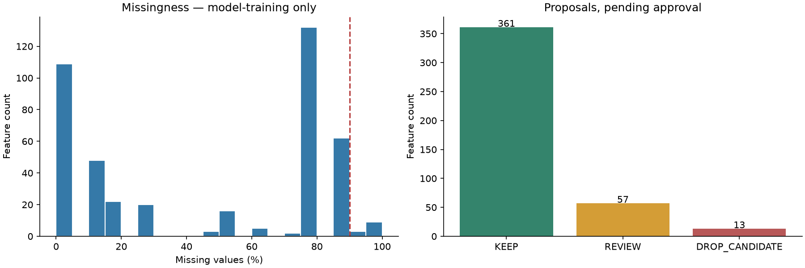
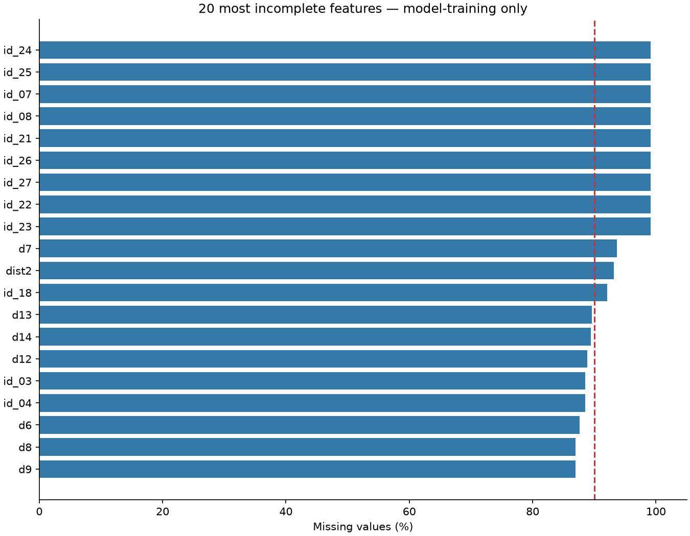
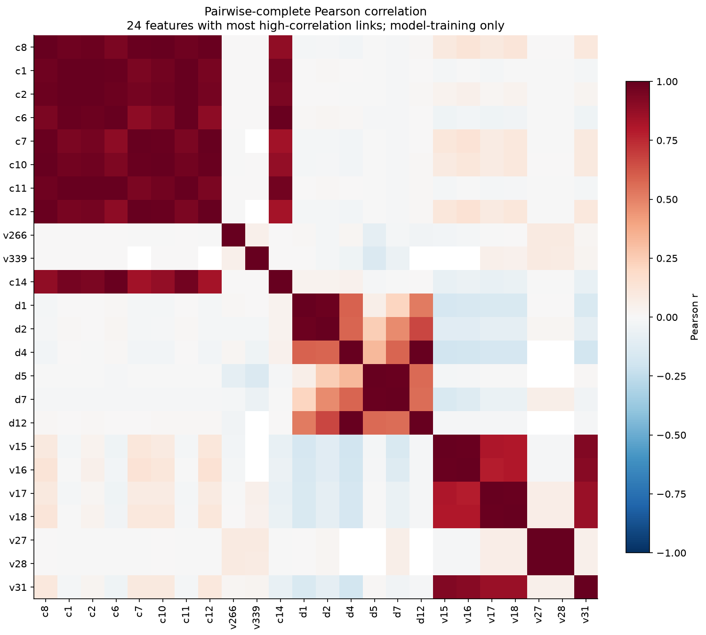

# IEEE-CIS preprocessing audit

Generated from PostgreSQL database `fraud_detection`, source `public.train_merge` and `public.test_merge`.
Audit schema: `feature_audit_20261014_v1`. **Executed; no feature removal or final cleaned datasets created. Approval pending.**

## Dataset and chronology

- Labeled training: **590,540 rows**, **434 columns**, including 3 protected metadata/target columns and **431 eligible predictors**.
- Unlabeled test: **506,691 rows**, **433 columns**.
- Earlier model-training partition: **472,432 rows**; later validation: **118,108 rows**.
- Split cutoff: `transactiondt <= 12192842` for fitting, greater for validation. The requested 80% boundary uses `percentile_disc`; timestamp ties stay together.
- Four approximately equal chronological windows within the fitting partition assess stability. No validation or test values fitted selection rules.
- Fraud cases in fitting: **16,599**; validation: **4,064**.
- Full-training profiles are descriptive only (`data_quality_all_training.csv`). The required primary reports and all decisions use the model-training partition.
- `transactionid` and `isfraud` are never predictors; `transactiondt` is retained for ordering/evaluation and excluded from the default feature list.

## Calculated findings

| Finding | Model-training result |
|---|---:|
| Predictors with missing rate >90% | 12 |
| All-NULL predictors | 0 |
| Constant non-NULL predictors (may also be near-constant) | 0 |
| Near-constant predictors (>99.5% of all rows; includes constants) | 12 |
| High-correlation numeric pairs, abs(r)>=0.98 | 39 |
| High-correlation pairs below minimum support | 0 |
| High-correlation pairs unstable/unsupported across windows | 20 |
| Exact duplicate feature pairs | 0 |
| Connected redundancy groups | 25 |
| KEEP predictors | 361 |
| REVIEW predictors | 57 |
| DROP_CANDIDATE predictors | 13 |
| Remaining predictors if ALL proposed drops approved | 418 |
| Remaining train columns including metadata/target | 421 |
| Remaining test columns including ID/time | 420 |

Full labeled-training predictors above 90% missing (descriptive, not fitted): **12**.

## Methods and safeguards

- SQL inspects metadata and profiles every column. NULL counts, distinct non-NULL values, dominant non-NULL values, labels, numeric NaN/infinities, window profiles and duplicate-column candidates are calculated in PostgreSQL.
- Dominant percentage uses **all rows** as denominator and a non-NULL value as numerator; NULL dominance is reported separately as missingness. All-NULL, constant, and near-constant conditions may overlap except all-NULL; do not sum overlapping counts.
- High missingness is a drop candidate only when the conservative fraud-association screen does not require review. Missingness versus presence and rare non-NULL versus dominant values use Fisher exact tests with Benjamini–Hochberg adjustment within each test family, q<0.01 and absolute fraud-rate difference >=0.5 percentage points. At least 100 rows and 5 fraud cases in each group are required for supported evidence. These are exploratory screens, not causal or predictive proofs.
- Missingness association direction is also reported across fitting windows. Insufficient evidence never proves irrelevance. Near-constant rare values remain REVIEW unless an exact/stable redundant representative preserves their signal.
- Pearson includes numeric measurements/anonymized counts only. All card fields, address codes, text fields and id_12–id_38 are conservatively treated as categorical/unverified codes. Low integer cardinality alone is not enough to call a V/C/D measurement categorical; semantic assignments require domain review.
- Correlations use all pairwise finite/non-NULL fitting observations, no sampling or imputation. Reliable support requires at least **4,725** paired rows (max of 1,000 and 1% of fitting rows). Proposed correlation removal also requires all four windows to have >=200 shared rows, abs(r)>=0.95, matching sign, and identical NULL patterns.
- Chunked, centered/scaled sufficient statistics improve numerical conditioning only; no stored data is scaled or imputed. Selected correlations and shared counts are independently verified against PostgreSQL `corr` and `regr_count` (`correlation_validation.csv`). Zero-variance pairs have undefined correlation and are excluded.
- Exact duplicate detection fingerprints row-aligned values INCLUDING NULL pattern, then confirms candidate equality directly in SQL. Both numeric and categorical fields are considered. No transactions are deduplicated by feature similarity.
- Group selection is deterministic: lower missingness, then smaller chronological missingness variation, smaller mean variation relative to standard deviation, then lexical tie-break. Each redundant drop points directly to a retained representative; correlation is not treated as transitive. Exact duplicates need no model importance to establish equivalence within the fitting data.
- Predictive importance and LightGBM experiments A/B/C were **not executed**. Optional model comparison is deferred; there is no claim that a proposed drop improves PR-AUC or preserves predictive performance.
- A candidate can be REVIEW for sparse/unstable pair evidence; master decisions are the authoritative combined recommendations. Pair suggestions never independently authorize a deletion.

## Integrity and leakage

| Table | Rows | Missing IDs | Duplicate ID excess | Missing time | Missing labels | Invalid labels | Missing amount | Negative amount |
|---|---:|---:|---:|---:|---:|---:|---:|---:|
| train_merge | 590540 | 0 | 0 | 0 | 0 | 0 | 0 | 0 |
| test_merge | 506691 | 0 | 0 | 0 | N/A | N/A | 0 | 0 |

- Train/test overlapping transaction IDs: **0**.
- Numeric NaN/infinity cells in model-training: **0**; full labeled training: **0**.
- Train/test schema differences requiring review: **0**. The absent test label is expected.
- Native PostgreSQL numeric columns cannot contain arbitrary invalid text; failed CSV imports or meaning-specific sentinels cannot be reconstructed from these tables. Numeric category codes are not automatically continuous features.
- Transaction-time ordering is checked, but the anonymized C/D/V/id features have unverified acquisition times. Unknown meaning is NOT evidence of leakage. Confirm availability at decision time; do not construct aggregates from future records or labels.
- Identity records can be absent legitimately. Preserve such transactions and native numeric NULLs. Test labels are unavailable, so test cannot supply labeled RL rewards or measured fraud performance.
- Static historical CSVs do not identify counterfactual action outcomes. RL reward design and environment simulation remain separate research tasks.

## Feature groups

| Group | KEEP | REVIEW | DROP_CANDIDATE |
|---|---:|---:|---:|
| C1–C14 | 6 | 5 | 3 |
| D1–D15 | 9 | 6 | 0 |
| Other transaction and identity | 18 | 1 | 0 |
| V1–V339 | 294 | 35 | 10 |
| card1–card6 | 6 | 0 | 0 |
| id_01–id_38 | 28 | 10 | 0 |

No entire group is removed automatically. Full group evidence is in `feature_group_summary.csv` and `feature_selection_report.csv`.

## Recommended retention and review

**KEEP:** transactionamt, productcd, card1, card2, card3, card4, card5, card6, addr1, addr2, dist1, p_emaildomain, r_emaildomain, c1, c4, c5, c9, c13, c14, d3, d6, d8, d9, d10, d11, d13, d14, d15, m1, m2, m3, m4, m5, m6, m7, m8, m9, v1, v2, v3, v4, v5, v6, v7, v8, v9, v10, v11, v12, v13, v14, v17, v19, v20, v21, v22, v23, v24, v25, v26, v27, v29, v30, v31, v33, v34, v35, v36, v37, v38, v39, v40, v41, v42, v43, v44, v45, v46, v47, v48, v49, v50, v51, v52, v53, v54, v55, v56, v58, v59, v60, v61, v62, v63, v64, v65, v66, v67, v68, v69, v70, v72, v73, v74, v75, v76, v77, v78, v79, v80, v81, v82, v83, v84, v85, v86, v87, v88, v89, v90, v91, v93, v94, v95, v96, v97, v98, v99, v100, v101, v102, v103, v104, v105, v106, v109, v110, v112, v114, v115, v116, v123, v124, v125, v126, v127, v128, v129, v130, v131, v132, v133, v134, v136, v138, v139, v140, v141, v142, v143, v144, v146, v147, v148, v149, v151, v152, v153, v155, v156, v157, v158, v159, v160, v161, v162, v163, v164, v165, v166, v167, v168, v169, v170, v171, v172, v173, v174, v175, v176, v177, v178, v179, v181, v183, v184, v185, v186, v187, v188, v189, v190, v191, v192, v193, v194, v195, v196, v197, v198, v199, v200, v201, v202, v203, v204, v207, v208, v209, v210, v211, v212, v213, v215, v216, v217, v218, v219, v220, v221, v222, v223, v224, v225, v226, v227, v228, v229, v230, v231, v232, v233, v234, v235, v236, v237, v238, v239, v240, v241, v242, v243, v244, v245, v246, v247, v248, v249, v251, v252, v257, v258, v259, v260, v261, v262, v263, v264, v265, v267, v268, v270, v271, v272, v273, v274, v275, v277, v278, v279, v280, v281, v282, v283, v284, v285, v286, v287, v288, v289, v290, v292, v293, v294, v295, v296, v297, v298, v299, v300, v301, v302, v303, v304, v306, v307, v308, v309, v310, v312, v313, v314, v315, v316, v317, v318, v319, v320, v321, v322, v323, v324, v325, v326, v327, v328, v329, v330, v332, v333, v335, id_01, id_02, id_03, id_04, id_05, id_06, id_09, id_10, id_11, id_12, id_13, id_14, id_15, id_16, id_17, id_19, id_20, id_28, id_29, id_30, id_31, id_32, id_33, id_34, id_35, id_36, id_37, id_38, devicetype, deviceinfo.

**REVIEW (retain unless explicitly approved otherwise):** dist2, c3, c7, c8, c10, c12, d1, d2, d4, d5, d7, d12, v15, v16, v107, v108, v111, v113, v117, v118, v119, v120, v121, v122, v135, v137, v145, v150, v180, v182, v205, v206, v214, v253, v254, v255, v256, v266, v269, v276, v305, v311, v334, v336, v337, v338, v339, id_07, id_08, id_18, id_21, id_22, id_23, id_24, id_25, id_26, id_27.

## Proposed removals — approval required

| Feature | Retained representative | Reason |
|---|---|---|
| c2 | c1 | High correlation needs further review: insufficient temporal/support evidence or different missingness; Stable highly correlated feature represented by c1; keep representative. Importance not evaluated; this remains a proposal |
| c6 | c14 | Stable highly correlated feature represented by c14; keep representative. Importance not evaluated; this remains a proposal |
| c11 | c1 | Stable highly correlated feature represented by c1; keep representative. Importance not evaluated; this remains a proposal |
| v18 | v17 | Stable highly correlated feature represented by v17; keep representative. Importance not evaluated; this remains a proposal |
| v28 | v27 | Stable highly correlated feature represented by v27; keep representative. Importance not evaluated; this remains a proposal |
| v32 | v31 | Stable highly correlated feature represented by v31; keep representative. Importance not evaluated; this remains a proposal |
| v57 | v58 | Stable highly correlated feature represented by v58; keep representative. Importance not evaluated; this remains a proposal |
| v71 | v72 | Stable highly correlated feature represented by v72; keep representative. Importance not evaluated; this remains a proposal |
| v92 | v93 | Stable highly correlated feature represented by v93; keep representative. Importance not evaluated; this remains a proposal |
| v154 | v153 | Stable highly correlated feature represented by v153; keep representative. Importance not evaluated; this remains a proposal |
| v250 | v251 | Stable highly correlated feature represented by v251; keep representative. Importance not evaluated; this remains a proposal |
| v291 | v294 | Stable highly correlated feature represented by v294; keep representative. Importance not evaluated; this remains a proposal |
| v331 | v333 | Stable highly correlated feature represented by v333; keep representative. Importance not evaluated; this remains a proposal |

## Reproduction and next step

See `feature_audit/README.md` for execution commands. The audit snapshot, SQL outputs, package versions, thresholds and script hashes are retained. Reuse the same audit schema to regenerate from the same data snapshot; use a new schema for changed source data.
For this initial run, the test snapshot was captured separately after the training audit; its capture time is recorded in `run_metadata.csv`. Test values were not used for fitting. Future fresh runs snapshot both tables in one repeatable-read transaction.
Review `proposed_drops.csv`; place only approved names in `approved_drops.json`. The separate application script validates the subset and preserves original tables. It has not been run. No numeric imputation or scaling is required for the initial LightGBM baseline; categorical mappings must be fitted on the early training partition and reused for validation/test, with an explicit unknown-category policy.
Evaluate optional A/B/C models chronologically using PR-AUC, ROC-AUC, recall/FPR at a prespecified threshold, Brier/log loss and calibration plots, feature count, wall time and peak memory. Fit importance decisions inside the fitting partition or an inner chronological holdout, not on the final validation partition.

## References

- PostgreSQL aggregate definitions: https://www.postgresql.org/docs/17/functions-aggregate.html
- LightGBM native missing and categorical handling: https://lightgbm.readthedocs.io/en/stable/Advanced-Topics.html
